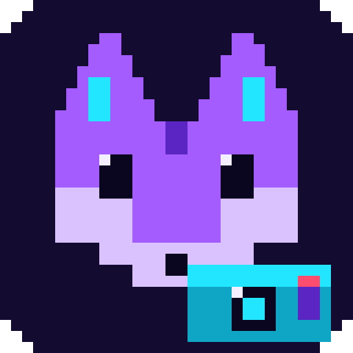

<p align="center">
  
</p>

# ReplayClip

Grabador de repeticiones para Windows 10/11: mantiene en RAM los últimos N segundos de juego y los
guarda en MP4 con un atajo, como la Barra de juegos de Xbox, con consumo mínimo y **sin inyección,
hooks, lectura de memoria ni drivers** (compatible con antitrampas de kernel como Riot Vanguard).

| Función | Cómo |
|---|---|
| Búfer de repetición (15–120 s, 30 por defecto) | `Ctrl+Shift+F9` guarda los últimos N s en MP4 |
| Grabación continua a disco | `Ctrl+Shift+F10` inicia / detiene (MP4 fragmentado, sin acumular en RAM) |
| Captura | Monitor completo (Desktop Duplication, sin borde amarillo) o ventana (Windows.Graphics.Capture) |
| Video | H.264 por hardware: NVENC, AMF o Quick Sync vía Media Foundation; respaldo por software |
| Audio | Pista 1 mezcla · pista 2 sistema · pista 3 micrófono (AAC 48 kHz) |
| Interfaz | Estilo retro Windows 95: icono pixel-art en la bandeja, menú clásico, ventana de ajustes; notificación con la ruta del clip; inicio con Windows |
| Sonidos | Tono corto al guardar un clip y al iniciar/detener la grabación (desactivable) |
| Editor de clips | Bandeja → *Editor de clips…*: une varios clips, recorta (marcar inicio/fin), divide, reordena y elige transición entre tramos (corte, disolver, fundido a negro, barrido); exporta a `Editado_*.mp4` recodificando con la GPU si la hay (solo la pista de audio 1, la mezcla) |

Los atajos se cambian en *Ajustes → Atajos y archivos*: haz clic en la casilla, pulsa la combinación y
**Guardar**. En teclados 60 % (sin fila de funciones) F9/F10 dependen de la capa Fn y a veces no llegan a
Windows combinados con Ctrl+Shift; `Ctrl+Shift+9` y `Ctrl+Shift+0` funcionan bien y no chocan con League
of Legends. Evita `Alt+Shift` (cambia el idioma del teclado) y `Ctrl+Alt` (equivale a AltGr en español).

## Requisitos

* Windows 10 versión 1903 o superior (x64), o Windows 11.
* [.NET 8 Desktop Runtime x64](https://dotnet.microsoft.com/download/dotnet/8.0) para ejecutar;
  [.NET 8 SDK](https://dotnet.microsoft.com/download/dotnet/8.0) (8.0.4xx) para compilar.
* GPU con codificador H.264 (cualquier NVIDIA GTX 600+, AMD GCN+ o Intel HD 4000+). Sin ella funciona
  igual, pero a 720p 30 fps y con más CPU.
* En ediciones "N" de Windows: Media Feature Pack (trae los codificadores de Media Foundation).

## Compilar y ejecutar (fase 3)

### Con la línea de comandos

```powershell
cd ReplayClip

# Depuración: compila la app y la herramienta de pruebas
dotnet build ReplayClip.sln -c Debug
.\src\ReplayClip\bin\Debug\net8.0-windows10.0.22621.0\win-x64\ReplayClip.exe

# Versión final (precompilada con ReadyToRun) en ReplayClip\publish\ReplayClip
dotnet publish src\ReplayClip\ReplayClip.csproj -c Release -o publish\ReplayClip
.\publish\ReplayClip\ReplayClip.exe
```

La carpeta `publish\ReplayClip` (~32 MB) es todo lo que hay que copiar a otro equipo con el
.NET 8 Desktop Runtime instalado.

### Con Visual Studio 2022 (17.8 o superior)

1. Abrir `ReplayClip\ReplayClip.sln`.
2. Configuración **Debug** o **Release**, plataforma **x64**.
3. Proyecto de inicio: **ReplayClip** → F5.
4. Para publicar: clic derecho en el proyecto → *Publicar* → *Carpeta*, o usar el comando de arriba.

Al arrancar, la app se queda en la bandeja del sistema (icono azul; rojo mientras graba) y muestra
una notificación con los atajos. Doble clic en el icono abre los ajustes.

### Dónde guarda las cosas

| Qué | Dónde |
|---|---|
| Clips y grabaciones | `Videos\ReplayClip` (configurable) |
| Ajustes | `%APPDATA%\ReplayClip\settings.json` |
| Registro | `%LOCALAPPDATA%\ReplayClip\logs\replayclip.log` (botón *Abrir registro* en Ajustes) |
| Inicio con Windows | `HKCU\Software\Microsoft\Windows\CurrentVersion\Run\ReplayClip` |

## Estructura

```
ReplayClip/
├─ src/ReplayClip/
│  ├─ Capture/   DesktopDuplicationSource, GraphicsCaptureSource, D3DDeviceManager, AdapterSelector,
│  │             FramePacer, CaptureTargetResolver, WindowEnumerator, WinRtInterop, HighResolutionTimer
│  ├─ Video/     VideoFrameConverter (BGRA→NV12 en GPU), H264Encoder (MFT), HardwareEncoderSelector,
│  │             CodecApiInterop, H264Bitstream
│  ├─ Audio/     WasapiCaptureSource, PcmTimeline, PcmConverter, AudioMixer, AacEncoder, AudioPipeline
│  ├─ Buffer/    ReplayRingBuffer, BlockPool, ReplaySnapshot
│  ├─ Muxing/    Mp4Muxer (IMFSinkWriter passthrough), ClipExporter, RecordingWriter
│  ├─ Hotkeys/   HotkeyManager (RegisterHotKey), HotkeyGesture
│  ├─ Settings/  AppSettings, SettingsStore, StartupRegistration
│  ├─ UI/        TrayIconController, SettingsWindow, Retro95Theme, ClipNotifier, HotkeyBox, SoundCues
│  ├─ Assets/    logo-zorro.png y ReplayClip.ico (se regenera con tools\Build-Icon.ps1)
│  └─ Core/      RecorderEngine, VideoPipeline, EncodedSampleBus, MediaClock, Logger
├─ tests/ReplayClip.Tests/       pruebas unitarias (xUnit, solo para desarrollo)
├─ tools/ReplayClip.SmokeTest/   prueba automática de extremo a extremo (ver docs/PRUEBAS.md)
├─ tools/Measure-ReplayClip.ps1  medición de CPU, GPU y RAM
└─ tools/Build-Icon.ps1          genera el .ico (16–256 px, píxeles nítidos) a partir del logo
```

Flujo: captura (GPU) → conversión NV12 y escalado (GPU) → H.264 por hardware → bus de muestras →
búfer circular en RAM y, si se graba, escritura en streaming → MP4 sin recodificar.

## Pruebas y medición (fase 4)

Ver [docs/PRUEBAS.md](docs/PRUEBAS.md).

## Limitaciones conocidas

* **Borde amarillo en modo ventana (Windows 10).** Windows lo dibuja en toda captura con
  Windows.Graphics.Capture; solo Windows 11 permite quitarlo (la app lo hace allí). El modo monitor usa
  Desktop Duplication y no lo muestra. El borde nunca aparece en el video.
* **Cursor en Windows 10 1903/1909** con captura de ventana: siempre se graba (la opción existe desde 2004).
* **Desktop Duplication** se interrumpe un instante con UAC, Ctrl+Alt+Supr o un cambio de resolución; la
  app se recupera sola y mientras tanto repite la última imagen. No captura contenido protegido (DRM).
  Solo funciona si el monitor está conectado a la misma GPU que codifica; si no, se usa WGC con borde.
* **Monitores rotados** (vertical) con Desktop Duplication: la imagen sale sin rotar.
* **Pantalla completa exclusiva**: la captura de ventana puede salir en negro; usar "sin bordes" o el modo monitor.
* **Resolución de salida fija** por sesión (la del monitor, hasta 1920×1080): si la ventana cambia de
  tamaño se escala con bandas negras en lugar de reiniciar el codificador y perder el búfer.
* **Codificación por software** (sin GPU compatible): 720p 30 fps y copia de cada fotograma a la CPU;
  no cumple el objetivo de CPU.
* **CBR**: el bitrate es constante, así que el tamaño en RAM es predecible pero las escenas quietas no
  se comprimen más. El driver de NVIDIA rechaza el parámetro para desactivar B-frames, pero en modo de
  baja latencia no los genera (verificado: los clips solo tienen slices I y P). El muxer asume DTS = PTS;
  si otro driver generara B-frames, la herramienta de pruebas lo detecta (cuenta los slices B) y habría
  que añadir el reordenamiento.
* **RAM** con 30 s a 20 Mbps: ~125 MB de conjunto de trabajo privado en la app real (Administrador de
  tareas). Con 120 s a 25 Mbps el búfer ocupa ~380 MB; la ventana de ajustes muestra la estimación.
* **Sonidos de confirmación**: salen por los altavoces, así que quedan en el audio del sistema de los clips
  siguientes y al principio y final de las grabaciones. Windows 11 permitiría excluir el audio de la propia
  app de la captura; Windows 10 no. Se pueden desactivar en Ajustes.
* **Pistas de audio**: muchos reproductores (Películas y TV, navegadores, Discord) solo reproducen la
  primera pista, que por eso es la mezcla. Sistema y micrófono por separado sirven para editar.
* **Deriva del reloj de audio**: se corrige insertando o quitando bloques de 20 ms cuando la diferencia
  con el reloj del sistema supera ese margen (puede oírse un microcorte cada varios minutos).
* **Grabación continua en MP4 fragmentado**: si la app se cierra de golpe, el archivo queda reproducible
  hasta el último fragmento (se renombra a `_recuperado.mp4` al volver a abrirla). Algunos editores
  antiguos no abren MP4 fragmentado.
* **Atajos**: si otra aplicación ya registró la combinación, la app avisa y hay que elegir otra.
* No hay forma de verificar desde la app la política de un antitrampas concreto; solo se usan APIs
  públicas de Windows (las mismas que la Barra de juegos y OBS) y no se abre ningún handle al proceso del juego.
